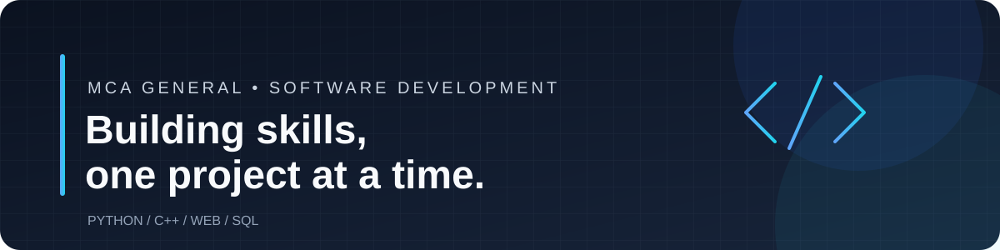

  

<h1 align="center">Hi, I'm Aditya Pratap Singh👋</h1>

<h3 align="center">MCA Student | Aspiring Software Developer</h3>

  Building my skills in programming, problem-solving and software development.

  
  

---

## 👨‍💻 About Me

- 🎓 Pursuing MCA at Chandigarh University.
- 💻 Interested in software development and software engineering.
- 🌱 Learning programming and building my technical foundation.
- 🧠 Practising problem-solving and improving my coding skills.
- 🎯 Goal: Become a skilled Software Developer / Software Engineer.

## 🛠️ Technologies I'm Learning

  
  
  
  
  
  
  

## 📂 Projects

I'm building my project portfolio as I learn.

**Coming soon:** My first documented software development projects.

> Add your real project repositories here when they are ready to showcase.

## 📊 GitHub Statistics

  
  

  

## 🎯 My Current Goals

- Strengthen programming fundamentals.
- Practise coding regularly.
- Build useful beginner-friendly applications.
- Learn Git and GitHub project management.
- Improve documentation and problem-solving.

## 🤝 Connect With Me

  

---

  <i>Learning every day. Building step by step. Growing as a developer.</i>

